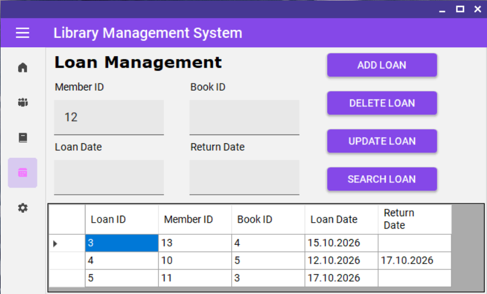
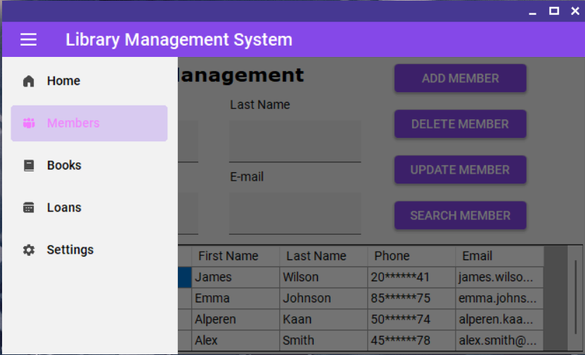

# Library Management System

A desktop library management application developed using **C# Windows Forms**, **SQL Server**, and **Entity Framework 6**.

## Features

- **Member Management:** Add, update, delete, search, and list library members.
- **Book Management:** Add, update, delete, search, and list books.
- **Loan Management:** Record book loans, process returns, search loan records, and delete loan entries.
- **Stock Tracking:** Manage book stock quantities.
- **Database Integration:** Store and retrieve data using SQL Server.
- **Language Support:** Switch between English and Turkish interface labels.

- **Custom Theme:** A purple-themed interface powered by MaterialSkin.

## Technologies Used

- C#
- Windows Forms (.NET Framework 4.7.2)
- Microsoft SQL Server
- SQL Server Management Studio (SSMS)
- Entity Framework 6 (Database First)
- MaterialSkin 2

## Database Structure

The application uses three main tables:

| Table | Description |
|---|---|
| `lbMembers` | Stores member information. |
| `lbBooks` | Stores book details and stock quantities. |
| `lbLoan` | Stores loan records, including loan and return dates. |

## Getting Started

1. Clone or download the repository.
2. Open the solution in Visual Studio.
3. Create the `LibraryDB` database in SQL Server.
4. Configure the database connection string in the project.
5. Ensure the Entity Framework model is connected to the database.
6. Build and run the application.

## Requirements

- Visual Studio
- SQL Server
- .NET Framework 4.7.2

## Purpose

This project was developed as an educational desktop application to practice Windows Forms development, database operations, Entity Framework, and basic library management workflows.

## License

This project is intended for educational purposes.
